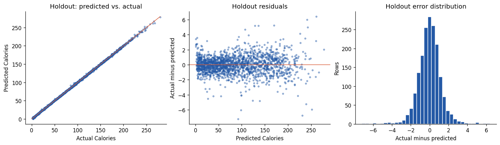
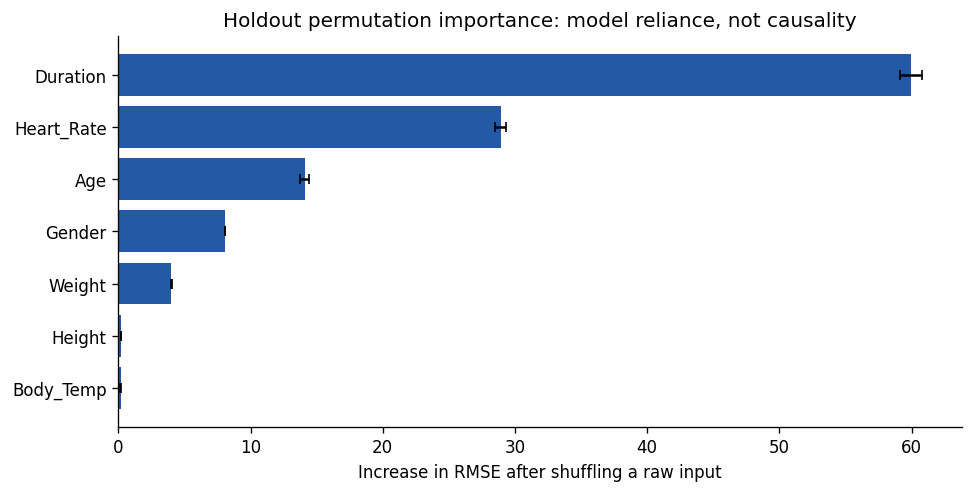

# Calorie Expenditure Prediction with XGBoost

A Group 2 project for **OmahTI Learning Center**, applying CRISP-DM to predict exercise calorie expenditure from participant and exercise attributes. The reproducible workflow compares regression baselines, tunes XGBoost, analyzes errors, and generates submission predictions.

**[Executed notebook](group-2-olc-final-project-bersih-v2.ipynb)** · **[Saved results](results/)** · **[Original submission](notebooks/archive/original-submission.ipynb)**

## Problem and data

Can the supplied attributes predict `Calories` more usefully than a constant or linear baseline? This is an academic exercise-expenditure task, not a food-intake predictor or a clinically validated calculator. The original “TiProduction” scenario is a teaching scenario, not evidence of a commercial client or deployment.

| File | Rows | Contents |
| --- | ---: | --- |
| `Train.csv` | 9,000 | Seven predictors, `User_ID`, and `Calories` |
| `Test.csv` | 6,000 | The same predictors and ID, **without target labels** |

Predictors are `Gender`, `Age`, `Height`, `Weight`, `Duration`, `Heart_Rate`, and `Body_Temp`. `User_ID` is excluded from modeling. The files have no missing cells or duplicate IDs, and their IDs do not overlap. One training predictor profile occurs twice under different IDs; no training profile overlaps the submission file.

The course materials do not fully establish provenance, measurement methods, feature units, or a separate dataset reuse license. The CSVs remain unchanged; [summary.json](results/summary.json) records their SHA-256 hashes. No claim is made that the data is independently verified clinical measurement or synthetic data.

## Approach

1. **Validate inputs:** expected columns, unique IDs, numeric/finite measurements, positive supplied predictors, and nonnegative targets. Missing predictors can be imputed; missing targets fail validation.
2. **Reserve a grouped 20% holdout:** a seed-42 split keeps identical predictor profiles together. This produces **7,200 development rows and 1,800 holdout rows**. Exploration uses development rows only.
3. **Fit preprocessing inside validation folds:** numerical median imputation, categorical imputation/one-hot encoding, and unseen-category handling live in a scikit-learn Pipeline. Only linear regression scales numeric inputs. IDs and targets never enter preprocessing; no full-data or test-specific IQR clipping is used.
4. **Compare four baselines on five common grouped folds:** mean DummyRegressor, linear regression, random forest, and XGBoost. RMSE, MAE, and R² are computed in one CV pass.
5. **Tune on development data only:** a seeded randomized search evaluates **12 XGBoost candidates × five folds**, using histogram trees and one parallelism layer. Select by development mean RMSE, then evaluate the frozen selection on the holdout without retuning or clipping predictions.
6. **Refit separately for submission:** after evaluation, fit a fresh clone on all labeled rows and predict `Test.csv` in its original ID order. This is distinct from the model whose holdout metrics are reported.

## Verified results

Saved outputs were generated with Python 3.13.3 and the pinned dependencies, seed 42, five grouped folds, and 12 search candidates.

### Development cross-validation

Means and sample standard deviations across the same five folds. Tuned-model CV statistics are selection statistics and may be optimistic after searching; they are not nested-CV estimates.

| Model | RMSE, mean ± SD | MAE, mean | R², mean |
| --- | ---: | ---: | ---: |
| Tuned XGBoost | **1.3715 ± 0.0817** | 0.9682 | 0.9995 |
| XGBoost baseline | 2.7232 ± 0.1110 | 1.8448 | 0.9981 |
| Random forest | 3.6348 ± 0.2239 | 2.2311 | 0.9966 |
| Linear regression | 11.2185 ± 0.3652 | 8.2838 | 0.9678 |
| Mean baseline | 62.5854 ± 0.5768 | 53.3813 | -0.0009 |

Selected XGBoost: 1,500 trees, depth 3, learning rate 0.1, subsample 0.9, column sampling 1.0, minimum child weight 1, and L2 regularization 1.0. Full settings and fold/search tables are in [results/](results/).

### Internal holdout: 1,800 rows

| Metric | Result |
| --- | ---: |
| RMSE | **1.2056** |
| MAE | **0.8776** |
| R² | **0.999611** |
| Mean predicted-minus-actual error | +0.0114 |

RMSE and MAE use the supplied `Calories` target's units. No negative holdout predictions occurred. Individual errors can be larger than the average; inspect the residuals rather than treating one score as a guarantee.



Duration, Heart_Rate, and Age have the largest holdout permutation importance in this run. Importance measures model reliance, not causal effects; correlated inputs complicate interpretation. [Subgroup metrics](results/subgroup_metrics.csv) include counts and describe observed errors, not a fairness certification.



**Evaluation boundary:** the holdout is excluded from this revision's preprocessing fit, search, and selection. Earlier versions already analyzed the wider dataset, so this is internal re-evaluation, not independent external validation. Different splits and procedures mean these scores are not a direct before/after comparison with the original submission.

**No verified `Test.csv` RMSE is available:** that file has no `Calories` labels. The old README's historical 61%/39% testing claims are not reproduced or presented as current benchmarks.

## Run locally

Use Python **3.11–3.13**; the saved run was tested on **3.13.3**. From this repository:

```bash
python -m venv .venv
```

Activate with `.venv\Scripts\Activate.ps1` in PowerShell or `source .venv/bin/activate` on macOS/Linux. Then:

```bash
python -m pip install -r requirements.txt
python calorie_prediction.py --iterations 12 --folds 5 --jobs 4
python predict.py
```

Training regenerates `results/`, `assets/`, and ignored `artifacts/`, without Kaggle-only paths, network downloads, credentials, or a GPU. `--jobs` controls tree-estimator threads; CV/search are sequential to avoid nested oversubscription. `--data-dir` and `--output-dir` accept other locations. Artifacts and assets are written beside the results directory, so use a dedicated parent directory for each experiment.

`predict.py` accepts `--model`, `--input`, and `--output` paths. Its default model is the full-training-data `artifacts/submission_model.joblib`; the evaluated model is saved separately as `artifacts/development_model.joblib`. Both contain fitted preprocessing. Load only trusted joblib artifacts. The JSON summary represents XGBoost's default NaN missing-value setting as the string `"NaN"`.

### Execute the notebook and checks

```bash
python -m pip install -r requirements-dev.txt
python scripts/run_notebook.py
python -m pytest -q
```

The runner executes all cells in a fresh kernel using the current interpreter and replaces the notebook only on success. It reruns the full experiment. In a notebook UI, select the project environment, restart the kernel, and run all cells in order. The CSVs must remain beside `calorie_prediction.py`.

Tests cover grouped split isolation, training-only preprocessing, unseen categories, invalid schemas/targets, submission order, and end-to-end outputs. A counterfactual test changes **only holdout labels** and requires model selection and development CV scores to remain unchanged. CI is configured for Python 3.11 and 3.13.

## Files and limitations

| Path | Purpose |
| --- | --- |
| Root notebook | Current CRISP-DM narrative and executed outputs |
| `calorie_prediction.py` | Validation, grouped splitting, pipelines, selection, evaluation, and refit |
| `diagnostics.py` / `predict.py` | Regenerated figures / inference with original ID order |
| `results/` | Summary, CV/search scores, holdout errors, split membership, and subgroup/importance tables |
| `assets/` | Figures from the actual experiment |
| `notebooks/archive/` | Original course notebook, unchanged and historical |
| `tests/` | Workflow and evaluation-boundary checks |

This small dataset may encode a very regular relationship. High R² does not establish accuracy on independent people, exercise types, devices, or future data. Profile grouping prevents exact-duplicate leakage but cannot infer undocumented participant/site dependencies; a random holdout is not a prospective study. Provenance, units, and dataset reuse rights need stronger documentation. No clinical validation, causal interpretation, or production deployment is claimed.

Independent validation, prediction intervals, physical constraints, and real-use utility are future work. Further tuning should use development data or a new evaluation set, not this reported holdout.

References: [scikit-learn common pitfalls](https://scikit-learn.org/stable/common_pitfalls.html), [GroupKFold](https://scikit-learn.org/stable/modules/generated/sklearn.model_selection.GroupKFold.html), [XGBoost API](https://xgboost.readthedocs.io/en/stable/python/python_api.html#xgboost.XGBRegressor).
